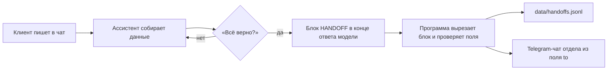
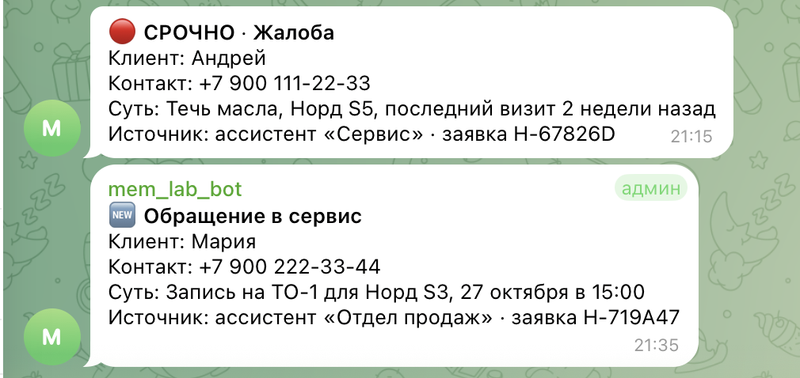

# Нейроассистенты для автоцентра «ВекторАвто»

Три ИИ-ассистента для вымышленного автосалона: отдел продаж, сервис и HR. Каждый отвечает клиентам
по своему системному промпту и базе знаний, собирает данные, переспрашивает «Всё верно?» и только
после подтверждения передаёт заявку в Telegram-чат отдела, который будет её обрабатывать.

Учебный проект курса «Промпт-инжиниринг 2.0» (Зерокодер). Компания, марка «Норд», цены, контакты
и люди в примерах вымышлены.

| Ассистент | Что делает |
|---|---|
| Отдел продаж (`sales`) | подбор автомобиля в бюджете, тест-драйв, трейд-ин, кредит, работа с возражениями |
| Сервис и постпродажа (`service`) | гарантия, ТО, запись в сервис, экстренные ситуации, жалобы |
| HR (`hr`) | вакансии, первичный отбор, приглашение на интервью, запросы сотрудников |

## Как устроена передача заявок



Модель дописывает в конец ответа технический блок `<<HANDOFF>> {...} <<END>>` с полями
`to`, `type`, `priority`, `client_name`, `contact`, `summary`. Программа убирает его из текста
для клиента, сохраняет заявку в файл и отправляет в чат отдела из поля `to`. Жалобы и экстренные
обращения (`priority: high`) приходят с пометкой «СРОЧНО». Любой ассистент может передать обращение
в чужой отдел: вопрос о ТО, заданный ассистенту продаж, получит чат сервиса.



## Результаты тестирования

Модель `gpt-4o-mini`, temperature 0.4. Каждый сценарий оценивается автоматически: нужная заявка
(отдел, тип, приоритет), обязательные и запрещённые фразы, содержимое сообщения «Всё верно?».

| Проверка | Полные промпты | Версии для GPTs (до 8 000 символов) |
|---|---|---|
| Критичные сценарии (скидка и взлом промпта, ДТП на трассе, вопросы о возрасте и поле), 3 × 3 прогона | 9 из 9 | 9 из 9 |
| Все сценарии продаж, 5 × 3 прогона | 15 из 15 | 14 из 15 |
| Автотесты без API (`pytest`) | 53 из 53 | — |

Полные отчёты с диалогами — в [`docs/test-reports/`](docs/test-reports/).

Повторные прогоны нашли ошибки, которые не видны при одиночном запуске: ассистент продаж отказывался
записать на ТО, хотя клиент дал контакты; при подборе первой предлагал модель дороже бюджета;
не всегда называл требования к водителю. Промпт исправлен и перепроверен.

**Известное ограничение.** Версия продаж для GPTs в 1 из 3 прогонов не повторяет в подтверждении
взнос и срок кредита, если клиент назвал их внутри вопроса о платеже. Полная версия проходит этот
сценарий 3 из 3; в версии для GPTs осталось меньше 30 свободных символов из 8 000.

## Что я сделал

- Написал системные промпты трёх ассистентов и базу знаний по каждому отделу: FAQ, типовые обращения, скрипты по ролям.
- Разработал формат межотдельной заявки и консольное Python-демо на OpenAI API, которое её разбирает, сохраняет и отправляет в Telegram.
- Собрал стенд тестирования: 14 сценариев с автооценкой, повторные прогоны, 53 автотеста без API.
- По результатам прогонов провёл несколько итераций правок промптов.
- Подготовил версии промптов для конструктора GPT (до 8 000 символов).

Инструменты: Python, PyCharm, OpenAI API, Telegram Bot API, pytest. Код и промпты писал вместе с ИИ-ассистентом Claude.

## Структура

```
vectorauto_assistants/
├── prompts/            # системные промпты (основной результат по ТЗ)
│   ├── sales.md
│   ├── service.md
│   └── hr.md
├── prompts_nocode/     # версии промптов для GPTs и no-code (до 8 000 символов)
├── knowledge/          # база знаний: общая + по отделам (FAQ, типовые обращения, скрипты)
│   ├── company.md
│   ├── sales_kb.md
│   ├── service_kb.md
│   └── hr_kb.md
├── app/
│   ├── assistants.py   # реестр ассистентов, сборка «промпт + база знаний»
│   ├── chat.py         # диалог с OpenAI API, история, обработка ошибок
│   ├── handoff.py      # разбор и сохранение заявок между отделами
│   ├── notify.py       # отправка заявок в Telegram-чаты отделов
│   ├── evaluate.py     # автооценка прогонов сценариев
│   └── transcript.py   # запись диалогов в файлы
├── docs/
│   ├── screenshots/    # скриншоты чатов отделов в Telegram
│   └── test-reports/   # итоговые отчёты повторных прогонов
├── tests/
│   ├── scenarios.json  # тестовые диалоги для проверки промптов
│   ├── test_prompts.py # все ли разделы из ТЗ есть в промптах и базе знаний
│   ├── test_handoff.py # разбор заявок
│   ├── test_chat.py    # логика диалога (без API)
│   ├── test_evaluate.py # автооценка
│   └── test_notify.py  # отправка в Telegram (без сети)
├── main.py             # консольный чат
├── run_scenarios.py    # автоматический прогон тестовых диалогов → отчёт
├── build_nocode.py     # сборка prompts_nocode/ из prompts/
├── telegram_setup.py   # проверка бота и поиск id чатов отделов
├── config.py           # настройки из .env
├── requirements.txt
└── .env.example
```

## Установка в PyCharm

1. Распакуйте архив и откройте папку `vectorauto_assistants` через **File → Open**.
2. Создайте виртуальное окружение: **Settings → Project → Python Interpreter → Add Interpreter → Virtualenv** (Python 3.9 или новее).
3. Откройте терминал PyCharm (внизу вкладка **Terminal**) и выполните:
   ```
   pip install -r requirements.txt
   ```
4. Скопируйте `.env.example` в `.env` и впишите свой ключ в `OPENAI_API_KEY`.
   Если используете прокси-сервис, совместимый с OpenAI API, укажите его адрес в `OPENAI_BASE_URL`.

## Запуск

| Что | Команда |
|---|---|
| Тесты без API (ключ не нужен) | `pytest` |
| Чат с ассистентами | `python main.py` |
| Прогон всех тестовых диалогов | `python run_scenarios.py` |
| Прогон одного ассистента | `python run_scenarios.py --assistant hr` |
| Прогон no-code-версий промптов | `python run_scenarios.py --nocode` |
| Критичные сценарии по 3 раза (стабильность) | `python run_scenarios.py --critical --repeat 3` |
| Пересобрать no-code-версии после правки `prompts/` | `python build_nocode.py` |
| Проверить бота и узнать id чатов | `python telegram_setup.py` |
| Отправить тестовую заявку в каждый чат | `python telegram_setup.py --test` |

Команды в чате: `/menu`, `/reset`, `/handoffs`, `/help`, `/exit`.

Результаты:
- диалоги из чата — `data/transcripts/`;
- заявки из чата — `data/handoffs.jsonl`;
- отчёты прогона сценариев — `reports/scenarios_<дата>.md` и `reports/handoffs_<дата>.jsonl`.

Каждый прогон оценивается автоматически по ожиданиям из `tests/scenarios.json` (поле `expect`):
нужная заявка (отдел, тип, приоритет), обязательные и запрещённые фразы, содержимое
сообщения-подтверждения «Всё верно?». Предупреждение «передал без заявки» — провал.
В начале отчёта — таблица «пройдено N из M» по каждому сценарию.

## Заявки в Telegram

Менеджер видит заявку в чате своего отдела сразу после того, как клиент подтвердил данные.

1. В Telegram откройте @BotFather → `/newbot` → получите токен бота.
2. Создайте группы отделов (или одну общую для демо) и добавьте туда бота.
3. Впишите токен в `.env` → `TELEGRAM_BOT_TOKEN`. Напишите в каждую группу любое сообщение.
4. Запустите `python telegram_setup.py` — он покажет id чатов. Впишите их в `.env`
   (`TELEGRAM_CHAT_SALES`, `TELEGRAM_CHAT_SERVICE`, `TELEGRAM_CHAT_HR` или один `TELEGRAM_CHAT_DEFAULT`).
5. Проверка: `python telegram_setup.py --test`, затем `python main.py`.

Заявка уходит в чат отдела из поля `to`: если ассистент продаж передал вопрос про ТО, сообщение
получит сервис. Если Telegram не настроен или недоступен, заявка всё равно сохраняется в файл,
а в чате программы выводится предупреждение. Прогон сценариев (`run_scenarios.py`) в Telegram не пишет,
чтобы не засорять чаты тестовыми заявками.

## Перенос в GPTs или no-code

1. **Instructions** — файл `prompts_nocode/<ассистент>.md`: версия без технического блока заявки, до 8 000 символов (лимит конструктора GPT; проверяется тестом).
2. **Knowledge** — файлы `knowledge/company.md` и `knowledge/<ассистент>_kb.md`.
3. Полные промпты с передачей заявок (`prompts/`) работают только вместе с Python-демо: в no-code блок `<<HANDOFF>>` некому вырезать.
4. OpenAI заменяет Custom GPTs на плагины (отключение GPT — 11.12.2026). Схема «инструкции + файлы» сохраняется, поэтому перенос делается так же.

## Ограничения демо

- Это консольный прототип, не продакшен: клиент общается через консоль, а не через сайт или мессенджер.
- Заявки доходят до Telegram-чата отдела, но статус обработки (взята в работу, закрыта) не отслеживается — для этого нужна CRM.
- Если Telegram был недоступен, заявка остаётся только в `data/handoffs.jsonl`; повторной отправки нет.
- Время тест-драйва, ТО и интервью ассистент не бронирует — он только передаёт заявку сотруднику.
- Качество ответов зависит от модели; результаты прогона сценариев нужно проверять вручную.
- Если выбранная модель не поддерживает параметр `temperature`, API вернёт ошибку — смените модель в `.env`.
